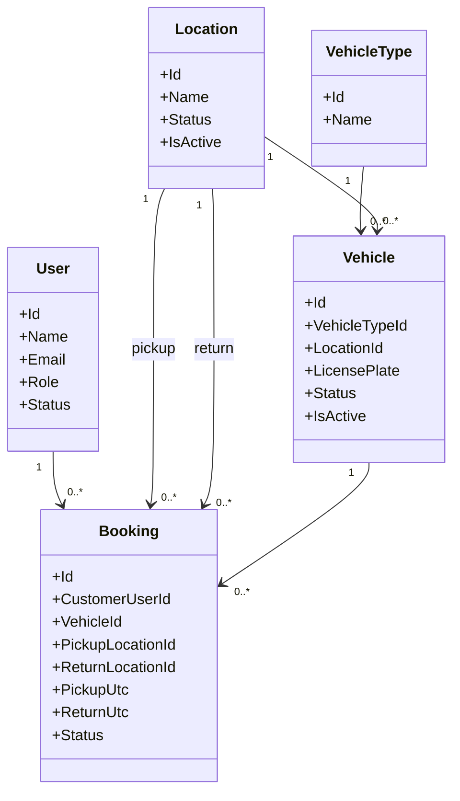

# 04. Domain Model

## 1. Purpose

This document defines the core domain model for the Vehicle Rental System based on the project definition in `docs/00-project-overview.md` and the requirements in `docs/01-requirements.md`, `docs/02-business-rules.md`, and `docs/03-use-cases.md`.

It intentionally does not define database schemas, detailed API contracts, or implementation mechanisms. Business policies that remain unspecified are marked as `TBD`.

---

## 2. Core Domain Concepts

The initial domain consists of the following core entities:

- User
- Vehicle
- VehicleType
- Location
- Booking

Despite their conceptual importance, these are not all equal in ownership or lifecycle responsibility.

---

## 3. Entity Responsibilities

### 3.1 User

Purpose:
- Represents a person who interacts with the system as either a customer or an administrator.

Responsibilities:
- Authentication and identity ownership.
- Role assignment and authorization context.
- Customer account lifecycle and administrative account lifecycle.

Important attributes (conceptual):
- Id
- Name
- Email
- Authentication information
- Role
- Status
- CreatedAt
- UpdatedAt

Relationships:
- A user may create many bookings as a customer.
- A user may have administrative responsibility for managing vehicles, locations, and booking workflow approvals depending on authorization rules.

Ownership:
- User Service

Notes:
- The exact profile model and password/session policy remain `TBD`.

### 3.2 Vehicle

Purpose:
- Represents a rentable asset in the fleet.

Responsibilities:
- Track the vehicle itself as a rentable asset.
- Maintain current lifecycle status and activity state.
- Support availability decisions based on business rules and booking overlap checks.

Important attributes (conceptual):
- Id
- VehicleTypeId
- LocationId
- LicensePlate
- Brand
- Model
- Year
- Status
- IsActive
- CreatedAt
- UpdatedAt

Relationships:
- A vehicle belongs to one vehicle type.
- A vehicle is associated with one location for allocation purposes.
- A vehicle can be referenced by many bookings over time.

Ownership:
- Vehicle Service

Notes:
- Availability is not just a permanent status flag; it is derived from the vehicle’s lifecycle and rental-period constraints.

### 3.3 VehicleType

Purpose:
- Represents the category of vehicle, such as Sedan, SUV, Hatchback, Motorbike, or Van.

Responsibilities:
- Define the category used to classify vehicles.
- Allow search and filtering by vehicle category.

Important attributes (conceptual):
- Id
- Name
- Description
- CreatedAt
- UpdatedAt

Relationships:
- A vehicle type may be assigned to many vehicles.

Ownership:
- Vehicle Service

Notes:
- Exact supported types remain `TBD`.

### 3.4 Location

Purpose:
- Represents a physical rental location.

Responsibilities:
- Define where vehicles are stored or picked up/returned.
- Support booking pickup/return location selection.

Important attributes (conceptual):
- Id
- Name
- Description
- Status
- IsActive
- CreatedAt
- UpdatedAt

Relationships:
- A location may contain many vehicles.
- A location may be used by many bookings as pickup or return locations.

Ownership:
- Vehicle Service

Notes:
- Exact naming standards and location hierarchy remain `TBD`.

### 3.5 Booking

Purpose:
- Represents a customer’s intention to rent a vehicle for a defined rental period.

Responsibilities:
- Capture the customer, vehicle, pickup location, return location, and rental period.
- Track booking lifecycle.
- Enforce booking validity and overlap prevention.
- Manage cancellation and completion rules.

Important attributes (conceptual):
- Id
- CustomerUserId
- VehicleId
- PickupLocationId
- ReturnLocationId
- PickupUtc
- ReturnUtc
- Status
- TotalPrice (future scope; not required by the MVP)
- CreatedAt
- UpdatedAt
- CancelledAt
- CompletedAt

Relationships:
- A booking belongs to one customer.
- A booking references one vehicle.
- A booking references one pickup location and one return location.
- A booking is the central aggregate for rental correctness and lifecycle enforcement.

Ownership:
- Booking Service

Notes:
- The booking aggregate is the domain boundary responsible for protecting against double booking.

---

## 4. Relationship Model

---

## 5. Aggregate Boundaries

### 5.1 User aggregate
- Aggregate root: User
- Consists of: user profile and authentication state
- Business invariants:
  - A user must have exactly one role context, such as Customer or Administrator.
  - A user must be in a valid account state.
- Notes:
  - This aggregate does not enforce booking overlap rules.

### 5.2 Vehicle aggregate
- Aggregate root: Vehicle
- Consists of: vehicle identity, active status, vehicle type reference, and location reference
- Business invariants:
  - A vehicle belongs to one type.
  - A vehicle belongs to one location assignment at a given time.
  - A vehicle cannot be used for a new booking when it is inactive or otherwise disallowed by business rules.
- Notes:
  - Vehicle status and availability are not synonymous.

### 5.3 Booking aggregate
- Aggregate root: Booking
- Consists of: booking identity, customer, vehicle, pickup/return locations, rental period, and booking lifecycle status
- Business invariants:
  - A booking must reference a valid customer, vehicle, and locations.
  - A booking must have a valid half-open interval: `PickupUtc < ReturnUtc`.
  - A booking status must be one of the valid lifecycle states.
  - A vehicle cannot have overlapping pending, confirmed, or active bookings.
  - A booking cannot transition to an invalid state.
- Notes:
  - This is the critical aggregate for correctness and concurrency.

---

## 6. Domain Invariants

The following invariants are required by the project definition and business rules:

- DI-01: A customer user shall not be able to modify another customer’s booking or vehicle data.
- DI-02: A vehicle shall have at most one reservation-holding booking overlap for a given interval when the bookings are pending, confirmed, or active.
- DI-03: A booking must use a half-open interval `[PickupUtc, ReturnUtc)`.
- DI-04: A booking with `ReturnUtc <= PickupUtc` shall be rejected.
- DI-05: A booking can only move through valid lifecycle transitions.
- DI-06: A cancelled booking shall not remain active for future rental use.
- DI-07: Availability is derived and must not be treated as a permanent static vehicle state.
- DI-08: The Booking Service is responsible for protecting booking consistency even when multiple requests are processed concurrently.
- DI-09: Cross-service database ownership must not be violated.
- DI-10: Booking Service is the source of truth for reservation/rental state; `Reserved` and `Rented` vehicle indications are derived and must not be written into the Vehicle DB by booking operations.

`TBD` remains for some detailed domain policies such as exact cancellation eligibility, lifecycle transition matrix beyond the base states, and exact administrative permission rules.

---

## 7. Entity Ownership Matrix

| Entity | Owner service | Notes |
|---|---|---|
| User | User Service | Authentication and roles |
| Vehicle | Vehicle Service | Vehicle lifecycle and fleet management |
| VehicleType | Vehicle Service | Vehicle categorization |
| Location | Vehicle Service | Pickup/return location model |
| Booking | Booking Service | Booking lifecycle and correctness |

---

## 8. Validation Against Project Definition

This domain model is consistent with the project overview and requirements because it preserves:

- three-service ownership model
- database-per-service boundaries
- customer and admin actor separation
- booking correctness as the central business problem
- vehicle and location ownership under the Vehicle Service
- user ownership under the User Service
- booking ownership under the Booking Service

The model intentionally avoids introducing new services, schema detail, or API designs beyond the required domain concepts.
