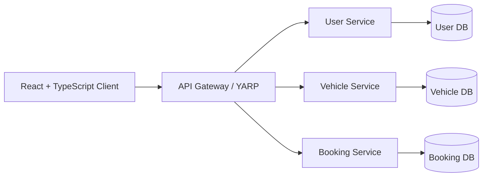
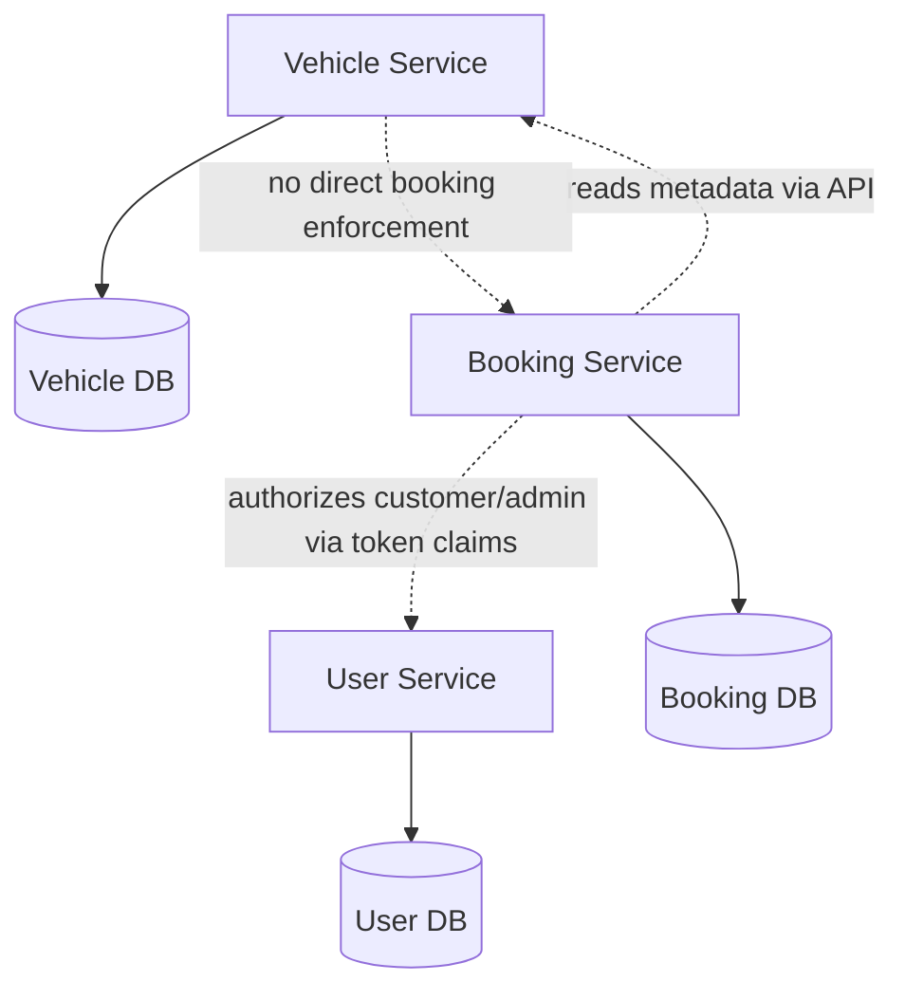

# 05. Service Boundaries

## 1. Purpose

This document defines the service boundaries for the Vehicle Rental System based on the definitions in `docs/00-project-overview.md` and the supporting requirements and business rules.

The scope intentionally remains at the conceptual service boundary level. It does not define detailed API contracts, database schemas, or implementation-specific libraries.

---

## 2. Service Landscape

The project intentionally defines a small initial architecture with three backend services:

This matches the project’s design principle of database-per-service and avoids unnecessary microservices.

---

## 3. Core Boundary Rules

- SR-01: The User Service owns only the User domain and User DB concerns.
- SR-02: The Vehicle Service owns only the Vehicle, VehicleType, and Location domain data and Vehicle DB concerns.
- SR-03: The Booking Service owns only the Booking domain and Booking DB concerns.
- SR-04: No service shall directly access another service’s database.
- SR-05: Cross-service communication shall occur through explicit integration mechanisms such as REST calls or events, not direct data joins.
- SR-06: The Booking Service is the authority for booking correctness, overlap prevention, and lifecycle validation.
- SR-07: No additional service shall be introduced unless a clear, justified future requirement emerges.

---

## 4. User Service

### Responsibility
The User Service is responsible for the identity and access domain of the system.

### Owned domain
- User
- User role
- Authentication context
- Account lifecycle state

### Owned data
- User records
- Authentication state and profile information as defined by the system design later
- Role and account status metadata

### APIs it exposes at a high level
- Register a customer account
- Authenticate a user
- Retrieve authenticated user profile information where required
- Validate user identity and role for authorization decisions

### Dependencies on other services
- May rely on shared concerns like secure token validation and role mapping, but it does not own booking or vehicle data.
- It may need to provide identity information to the Booking Service or gateway via integration patterns, but no direct database dependency is allowed.

### What it must NOT own
- Vehicle inventory
- Vehicle type and location metadata
- Booking lifecycle and rental reservations
- Booking availability logic

### Boundary note
The User Service does not directly participate in booking correctness enforcement.

---

## 5. Vehicle Service

### Responsibility
The Vehicle Service is responsible for the fleet and rental-location domain.

### Owned domain
- Vehicle
- VehicleType
- Location
- Vehicle lifecycle and operational state

### Owned data
- Vehicle catalog records
- Type metadata
- Location records
- Vehicle lifecycle status and activation state

### APIs it exposes at a high level
- Create a vehicle
- Update a vehicle
- Deactivate a vehicle
- Manage vehicle types
- Manage locations
- View vehicles and metadata
- Retrieve vehicle details and availability-relevant state for other service consumers

### Dependencies on other services
- It may be queried by Booking Service for vehicle existence checks and vehicle availability-related metadata when the business requires a read model or explicit integration.
- It is not allowed to directly own or enforce booking correctness logic.

### What it must NOT own
- Customer accounts
- Booking records
- Booking overlap validation
- Booking cancellation or completion logic

### Boundary note
The Vehicle Service owns the vehicle catalog, but the Booking Service owns the booking rules that determine whether a vehicle can be rented during a specific interval.

`Reserved` and `Rented` are derived indications from Booking Service data. The Vehicle Service does not persist those states or accept lifecycle writes from Booking Service.

---

## 6. Booking Service

### Responsibility
The Booking Service is responsible for booking creation, lifecycle management, and reservation correctness.

### Owned domain
- Booking
- Booking lifecycle states
- Booking validity and constraints
- Booking overlap logic
- Booking cancellation lifecycle

### Owned data
- Booking records
- Booking status and timestamps
- Booking period information
- Booking ownership links to customer and vehicle references
- Booking metadata needed for rental correctness and audit trail

### APIs it exposes at a high level
- Create booking
- View booking history
- View booking details
- Check booking availability for a date range
- Cancel eligible booking
- Confirm, reject, record pickup, return, and complete bookings through explicit lifecycle operations
- Manage booking lifecycle status updates where permitted

### Dependencies on other services
- It depends on the User Service for identity and authorization context when validating who is acting on a booking.
- It depends on the Vehicle Service for vehicle and location references, and possibly for validation of vehicle existence and deactivation state.
- It must use explicit integration patterns rather than direct database access.

### What it must NOT own
- User authentication and account management
- Vehicle catalog management
- Vehicle type catalog management
- Rental location master data ownership
- Payment or pricing logic
- Notification, review, or recommendation services

### Boundary note
This is the most critical service in the architecture because it must protect booking correctness under concurrency and invalid lifecycle transitions.

---

## 7. Service Ownership and Dependency Map

---

## 8. Non-Goals and Explicit Exclusions

The project definition explicitly excludes several services and responsibilities from the initial scope, including:

- Payment Service
- Notification Service
- Search Service
- Review Service
- Pricing Service
- Recommendation Service

These remain out of scope unless there is a clearly justified future need.

---

## 9. Validation Against Project Requirements

This service design remains consistent with the overview because it:

- preserves the three-service backend model
- keeps database ownership separate
- keeps User, Vehicle, and Booking responsibilities clear
- ensures Booking Service is the owner of booking integrity
- avoids unnecessary service decomposition
- does not define detailed API schemas or database designs

The following decision remains `TBD` where full service interactions and authorization details are not yet specified:

- exact integration contract for querying vehicle metadata from Booking Service
- exact authorization flow and token validation details between services
- exact event patterns for any later async integration
- exact rules for when a vehicle deactivation must block or delay booking changes

Implementation note:
- YARP now provides the configured external HTTP boundary and performs JWT/role authorization before forwarding. Each backend service continues to validate tokens and enforce domain authorization independently.
- Local development exposes the service ports directly for debugging. A deployed environment must publish only the Gateway ingress if service topology is to be hidden from external clients.

---

## 10. Service Boundary Summary

| Service | Primary Responsibility | Primary Domain | Owns Data | Must Not Own |
|---|---|---|---|---|
| User Service | Identity and access | User | User DB | Vehicle, booking domain |
| Vehicle Service | Fleet management | Vehicle, VehicleType, Location | Vehicle DB | User, booking domain |
| Booking Service | Rental reservations and booking correctness | Booking | Booking DB | User authentication, vehicle catalog ownership |

This remains the correct initial boundary for the project and is aligned with the core requirement that booking consistency must be protected by the Booking Service.
