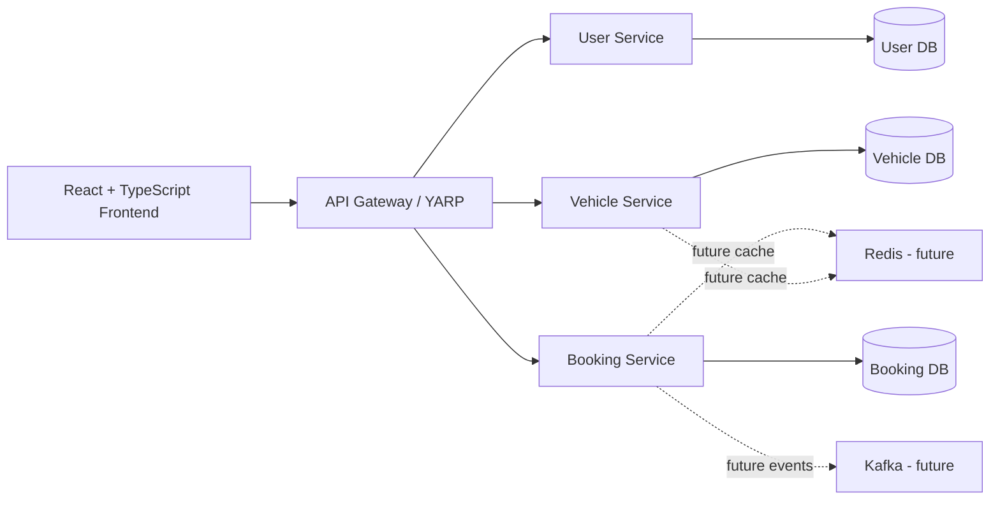
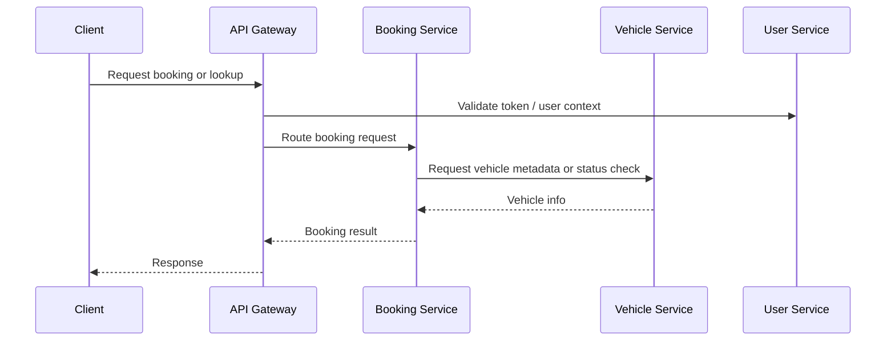
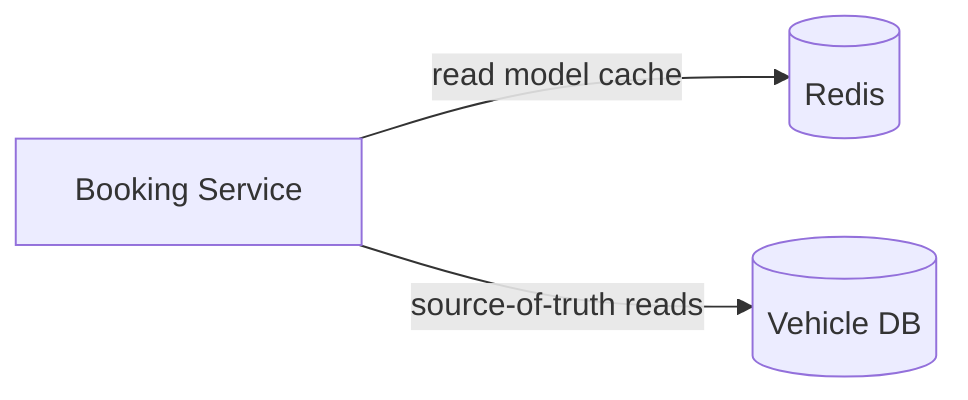
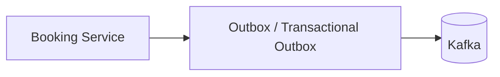

# 06. System Architecture

## 1. Purpose

This document defines the high-level architecture of the Vehicle Rental System based on the project definition and supporting requirements.

It deliberately stays at the architecture level. It does not define API contracts, database schemas, middleware frameworks, or detailed implementation logic. Where a decision is still open, it is marked as `TBD`.

---

## 2. Architecture Summary

The system is a small, learning-oriented platform with:

- One frontend application built with React + TypeScript
- One API Gateway using YARP
- Three backend services
- Three independent SQL Server databases following the database-per-service model
- Future optional Redis caching layer
- Future optional Kafka event-driven integration

---

## 3. Architectural Principles

### 3.1 Keep it small
- The initial scope remains limited to the three backend services already defined.
- No unnecessary service is introduced.

### 3.2 Correctness before optimization
- Booking correctness is a central architectural concern.
- Availability and overlap prevention must be enforced in the Booking Service domain boundary.

### 3.3 Database-per-service ownership
- User DB is owned by User Service.
- Vehicle DB is owned by Vehicle Service.
- Booking DB is owned by Booking Service.
- No service shall directly access another service’s database.

### 3.4 Explicit integration boundaries
- Service-to-service integration is done through explicit, documented mechanisms such as authenticated API calls or future events.
- Direct cross-service joins are prohibited.

---

## 4. Frontend

### Responsibility
The frontend provides customer and administrative user interfaces for:

- registration and login
- vehicle browsing and filtering
- vehicle details
- rental booking selection
- booking history and details
- cancellation and completion flows
- admin management for vehicles, vehicle types, locations, and booking records

### Boundary
- The frontend does not own business data.
- It communicates with the API Gateway, which routes requests to the appropriate backend service.

### Notes
- Frontend implementation details, state management, and UI component design are outside the scope of this architecture document.

---

## 5. API Gateway

### Responsibility
The API Gateway acts as the entry point for external traffic from the frontend.

### Role
- Route requests to the correct service
- Provide a unified external entry point
- Enforce centralized authentication and authorization boundary at the system edge
- Hide internal service topology from client consumers

### Important boundary rule
- Authentication and role-based access decisions shall be enforced before sensitive actions are processed by backend services.
- The exact token flow and service-to-service validation protocol remain `TBD`.

---

## 6. Backend Services

### 6.1 User Service

Responsibilities:
- User registration
- Authentication
- Role management
- User profile ownership
- Account lifecycle controls

Owned domain:
- User

Database ownership:
- User DB

Dependencies:
- Relies on its own data store for user identity and authorization state
- May provide identity and role information to other services through explicit integration mechanisms

Must not own:
- Vehicle management
- Booking lifecycle correctness
- Rental availability logic

---

### 6.2 Vehicle Service

Responsibilities:
- Vehicle catalog management
- Vehicle type management
- Location management
- Vehicle lifecycle status management
- Vehicle metadata exposure to the platform

Owned domain:
- Vehicle
- VehicleType
- Location

Database ownership:
- Vehicle DB

Dependencies:
- May be queried by Booking Service for vehicle existence, lifecycle state, and vehicle/location metadata when required by the business flow

Must not own:
- Customer accounts
- Booking creation rules
- Overlap detection logic
- Customer booking history

---

### 6.3 Booking Service

Responsibilities:
- Booking creation
- Booking retrieval
- Booking lifecycle management
- Rental-period validation
- Availability validation
- Booking overlap prevention
- Cancellation and completion handling

Owned domain:
- Booking

Database ownership:
- Booking DB

Dependencies:
- Requires user identity and authorization context from the User Service or token-based auth boundary
- May need vehicle metadata and deactivation state from the Vehicle Service through explicit integration

Must not own:
- User authentication data
- Vehicle master data
- Device/service-level identity system ownership
- Cross-service database storage

This service is the authoritative owner of booking correctness.

`Reserved` and `Rented` are derived indications from Booking Service records. Booking Service lifecycle operations do not write to the Vehicle DB; Vehicle operational status remains owned by Vehicle Service.

---

## 7. Service-to-Service Communication

The architecture requires explicit, controlled integration between services.

### Allowed patterns
- Authenticated REST calls from Booking Service to Vehicle Service for needed metadata checks
- Authenticated REST calls from the gateway to backend services
- Future event-driven integration using Kafka after the synchronous version is stable

### Not allowed
- Direct database joins across service databases
- Shared database access across service boundaries
- Implicit service coupling created by direct data access conventions

---

## 8. Authentication Boundary

### Boundary description
Authentication and role-based authorization are enforced at the edge and/or by the owning service depending on the implementation.

### High-level rule
- The User Service owns the user identity domain.
- The gateway and services validate the caller’s identity and role before executing protected operations.
- Customer and admin actions are separated at the authorization boundary.

### Current decision status
- Detailed token design, session policies, and exact trust boundaries are `TBD`.

---

## 9. Future Redis Integration

Redis is explicitly planned as a future optimization layer, not as the source of truth for booking correctness.

### Intended use cases
- Frequently requested vehicle read models
- Vehicle type and location caching
- Hot listing or lookup data
- Reduced repeated reads for catalog data

### Critical constraint
- Redis must never become the authoritative source for booking correctness.
- Booking overlap prevention and lifecycle validity remain governed by the Booking Service database.

---

## 10. Future Kafka Integration

Kafka is planned only after the synchronous system is stable and the project reaches a distributed integration stage.

### Potential future use cases

These are examples for future discussion only. None is an approved event contract or authorizes a producer, broker, or consumer implementation. An event requires a concrete async need and at least one named consumer before implementation.

- BookingCreated
- BookingConfirmed
- BookingCancelled
- BookingCompleted
- VehicleStatusChanged

### Architectural role
- Kafka is for asynchronous integration and eventual consistency after the core system is correct.
- It is not required for the initial MVP booking logic.

### Critical constraint
- The project must not add Kafka before the base booking correctness model is stable.

---

## 11. Booking Architecture

The booking flow is the most important architectural concern.

### Key architecture statement
- The Booking Service is responsible for validating the rental period, checking pending/confirmed/active bookings, and guaranteeing that overlapping reservation-holding bookings are rejected.
- Vehicle availability is derived from vehicle state plus booking overlap rules; it is not treated as a permanently static property.

### Core rule
- A booking must be validated using the half-open interval logic: `[PickupUtc, ReturnUtc)`.
- The overlap condition is:
  - `Existing.PickupUtc < New.ReturnUtc`
  - `Existing.ReturnUtc > New.PickupUtc`

### Concurrency guidance
- The architecture must handle concurrent booking requests without allowing double booking.
- The exact locking or transaction strategy is not finalized in the current project documentation and remains `TBD`.

---

## 12. Validation of Architecture Against Existing Documentation

This architecture is consistent with the project definition and the earlier design documents because it preserves:

- the three-service backend model
- database-per-service ownership
- the customer/admin separation
- booking correctness as a first-class design requirement
- Redis and Kafka as future, justified additions rather than initial requirements
- no new service introduction beyond the originally approved scope

### Consistency checks
- `docs/00-project-overview.md` requires 2–3 backend services, a single frontend, and database-per-service ownership.
- `docs/01-requirements.md` requires booking overlap prevention and validation.
- `docs/02-business-rules.md` defines the real booking correctness rules and shows the overlap logic.
- `docs/04-domain-model.md` names the Booking aggregate as the primary correctness boundary.
- `docs/05-service-boundaries.md` assigns Booking Service authority over booking integrity.

### Unresolved architecture decisions
- exact authorization token flow across gateway and services
- exact service-to-service contract for vehicle metadata lookup
- exact concurrency mechanism for booking validation
- exact idempotency key strategy and retry semantics
- exact future outbox/event design and Kafka contract

These are intentionally marked as `TBD` because the existing project definition does not finalize them.

---

## 13. Architecture Decision Summary

| Topic | Decision | Status |
|---|---|---|
| Frontend | React + TypeScript | Confirmed |
| Gateway | YARP | Confirmed |
| Services | User, Vehicle, Booking | Confirmed |
| DB model | Database-per-service | Confirmed |
| Booking correctness | Booking Service owns it | Confirmed |
| Redis | Future optimization | Planned |
| Kafka | Future async integration | Planned |
| Concurrency mechanism | TBD | TBD |
| Token/auth boundary | TBD | TBD |
