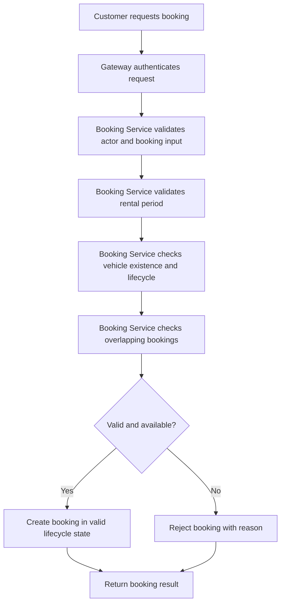
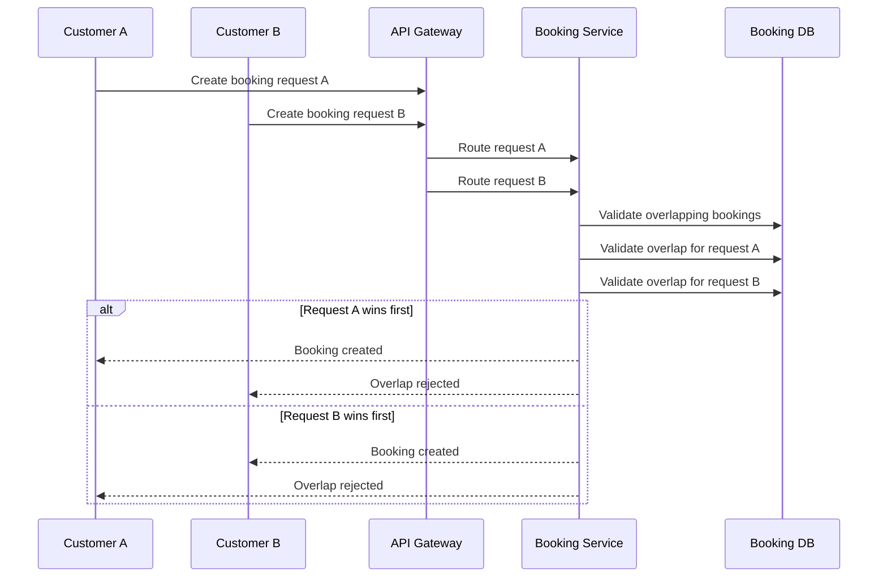
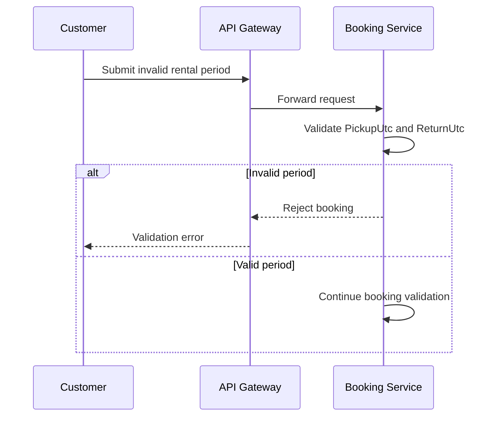
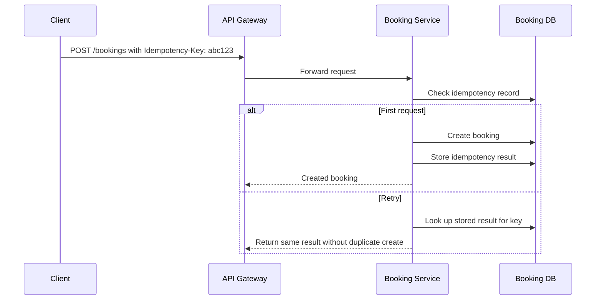
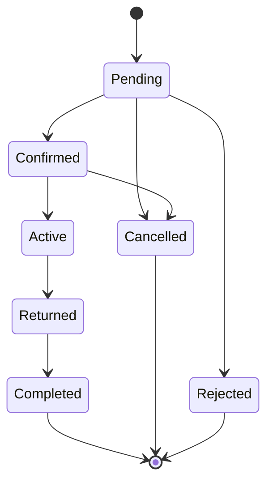

# 01. Booking Flow
## 1. Purpose

This document describes the high-level booking flow for the system, based on the project requirements and business rules.
It does not define detailed API payloads, database operations, or transaction implementation details. Unresolved decisions remain `TBD`.
---

## 2. Booking Flow Overview
The booking flow is orchestrated by the Booking Service and uses vehicle and user context as inputs.

---

## 3. Normal Booking

### Actor
- Customer

### Preconditions
- Customer is authenticated and authorized.
- Vehicle exists and is not deactivated under business rules.
- Pickup and return times are provided in UTC.
- Request is within valid period rules.

### Main flow
1. Customer selects a vehicle and rental period.
2. Frontend submits the booking request through the API Gateway.
3. API Gateway routes the request to the Booking Service.
4. Booking Service validates the actor and booking request.
5. Booking Service validates that the period is valid: `PickupUtc < ReturnUtc`.
6. Booking Service checks the vehicle is eligible for booking.
7. Booking Service checks for overlapping pending, confirmed, or active bookings for the same vehicle.
8. If no overlap exists, Booking Service creates a booking in the valid initial booking state.
9. Booking Service returns the created booking result.

### Alternative flow
- If no vehicle is available for the chosen period, the system returns a not-available result.

### Failure cases
- Invalid pickup/return times
- Vehicle inactive or disallowed
- Overlapping pending/confirmed/active booking
- Unexpected service or data failure

### Business rules involved
- BR-AVAIL-01 through BR-AVAIL-06
- BR-PERIOD-01 through BR-PERIOD-07
- BR-BOOK-01 through BR-BOOK-07
- BR-LC-01 through BR-LC-06

---

## 4. Concurrent Booking Requests

### Scenario
Two customers or two requests attempt to book the same vehicle for overlapping periods at nearly the same time.

### Requirement
The system must prevent both requests from succeeding for overlapping periods.

### Status
The architecture requires correctness under concurrency, but the exact locking, transaction, or isolation strategy is `TBD`.

### Business rules involved
- BR-CORE-04
- BR-PERIOD-04
- BR-PERIOD-05
- NFR-01

---

## 5. Invalid Booking

### Scenario
A customer submits an invalid booking request, such as a return time equal to or earlier than the pickup time.

### Business rule
- `ReturnUtc <= PickupUtc` is invalid.

### Business rules involved
- BR-PERIOD-03
- BR-BOOK-05

---

## 6. Booking Cancellation

### Actor
- Customer or Administrator, depending on the business rules and authorization scope.

### Preconditions
- Booking exists.
- Booking is in a state eligible for cancellation.

### Main flow
1. Customer selects a booking to cancel.
2. Booking Service validates the actor’s authorization.
3. Booking Service verifies the booking is in a cancellable state.
4. Booking Service records cancellation state and timestamp.
5. System confirms the cancellation.

### Alternative flow
- If the booking is already completed, rejected, or cancelled, cancellation is rejected.

### Business rules involved
- BR-CANCEL-01 through BR-CANCEL-05
- BR-LC-01 through BR-LC-06
- BR-AUTH-02
- BR-AUTH-03

---

## 7. Idempotent Retry

### Scenario
A client retries the same booking creation request using the same logical request identity.

### Requirement
The system must not accidentally create multiple bookings for the same logical operation.

### Status
The exact idempotency key approach and retries semantics remain `TBD`.

### Business rules involved
- BR-BOOK-01
- FR-08
- NFR-01

---

## 8. Booking Lifecycle Summary

The lifecycle is intentionally consistent with the project definition; the exact transition matrix beyond the initial lifecycle remains `TBD`.
