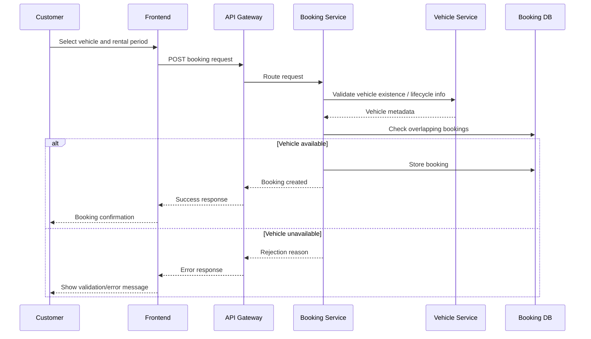
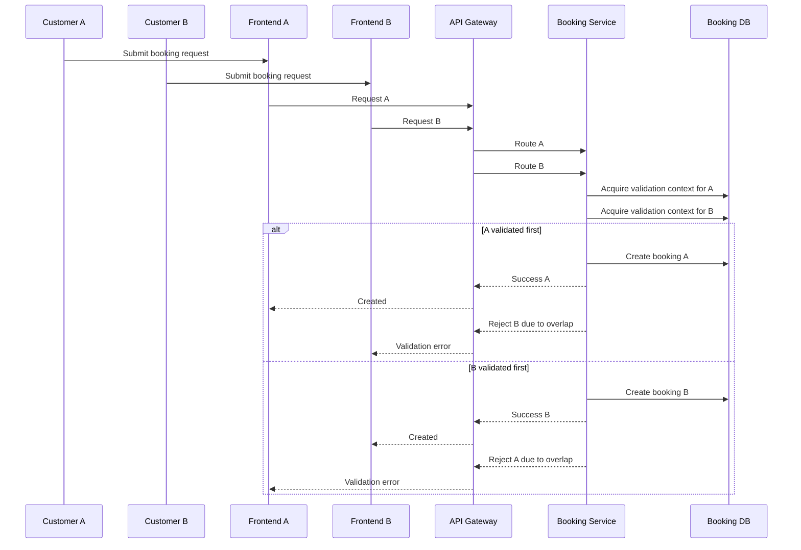
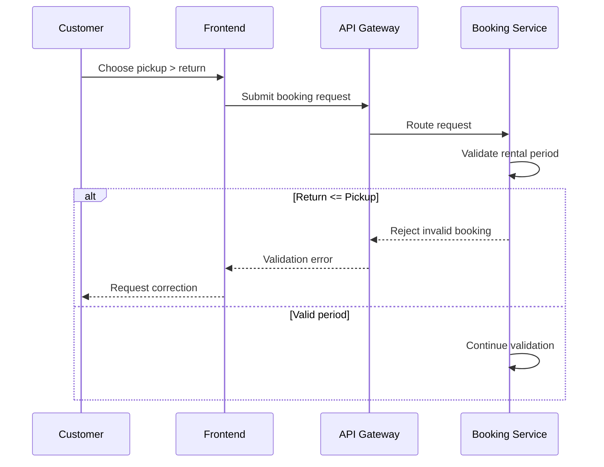
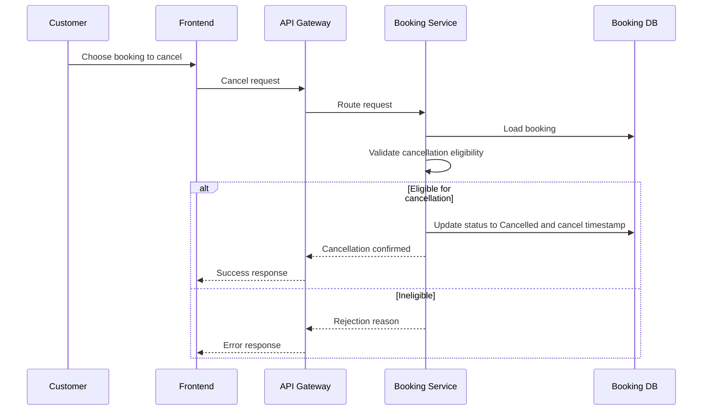
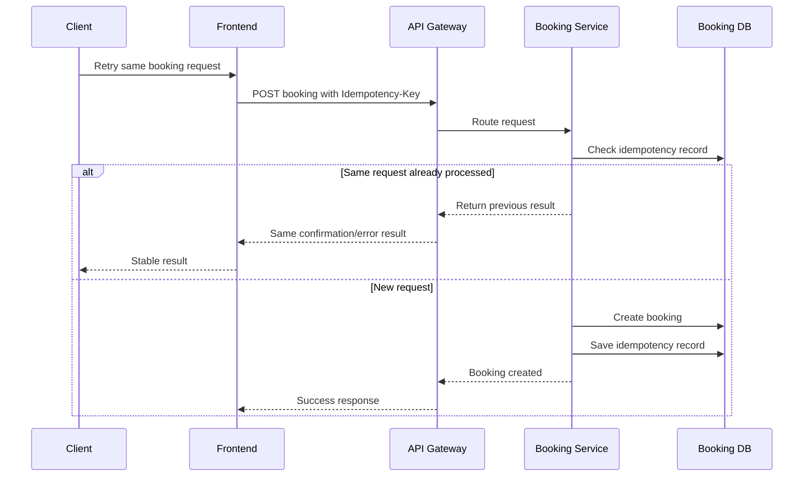
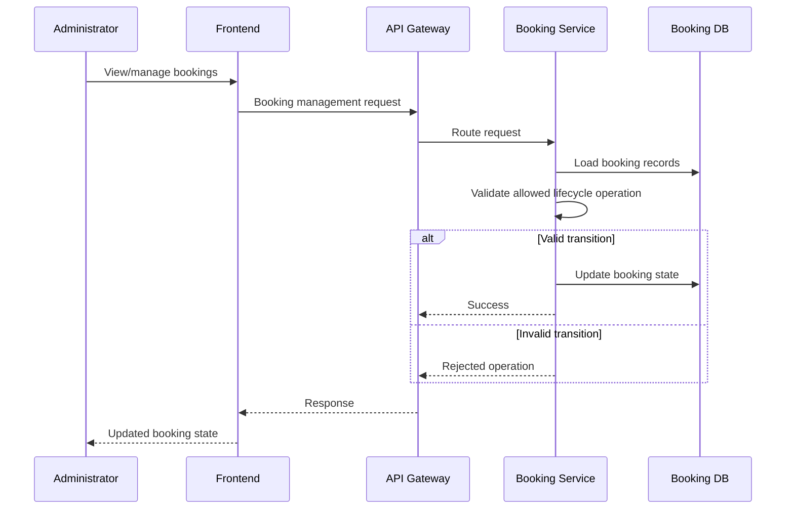
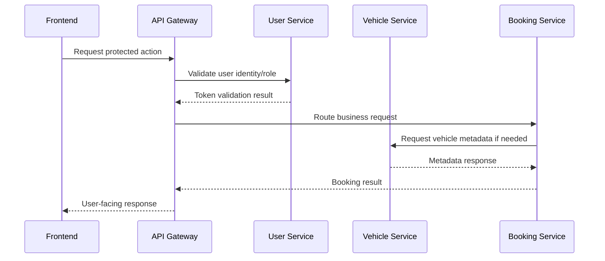

# 02. System Sequence Diagrams

## 1. Purpose

This document provides the main sequence diagrams for the system at the architecture level.

These diagrams are intentionally high-level and do not define concrete HTTP contracts, DTO shapes, or implementation details.

---

## 2. Customer Booking Sequence (Normal Flow)

---

## 3. Concurrent Booking Attempt Sequence

The architecture requires the system to reject one request in the overlap case, but the exact concurrency mechanism remains `TBD`.

---

## 4. Invalid Booking Sequence

---

## 5. Booking Cancellation Sequence

---

## 6. Idempotent Retry Sequence

The precise idempotency key handling strategy remains `TBD`.

---

## 7. Admin Booking Management Sequence

---

## 8. Cross-Service View

This reflects the controlled, explicit integration pattern required by the project.
