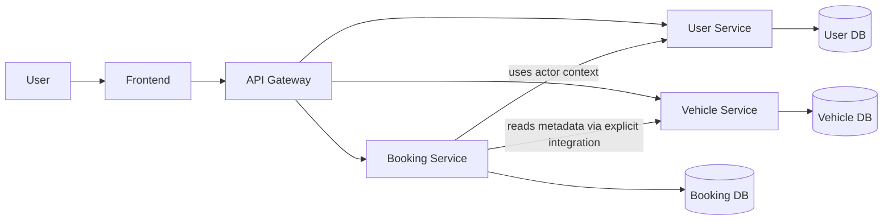
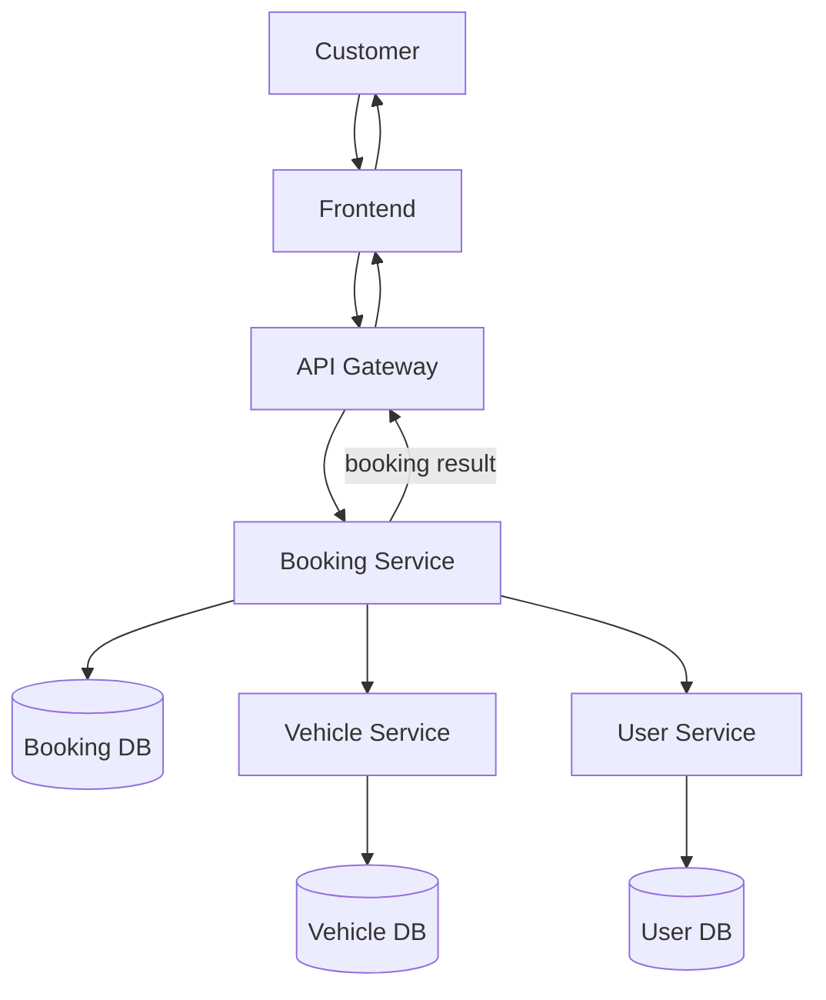
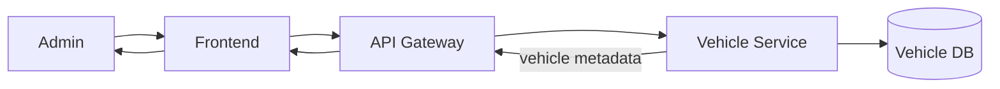
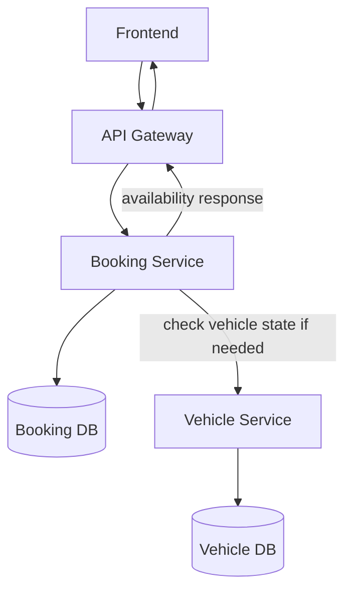
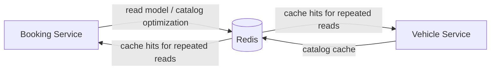
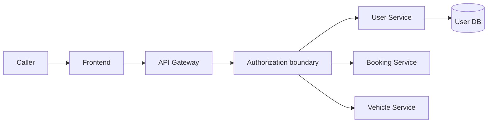

# 03. Data Flow

## 1. Purpose

This document describes the high-level data flow of the system at the architecture level.

It focuses on ownership flows and service boundaries rather than database schemas or implementation-specific details.

---

## 2. High-Level Data Flow

---

## 3. Customer Booking Data Flow

### Interpretation
- User identity is validated through the respective authorization boundary.
- Vehicle metadata is read through explicit service integration rather than cross-database joins.
- Booking records are persisted in the Booking DB, which remains the system-of-record for booking correctness.

---

## 4. Vehicle Catalog Data Flow

### Interpretation
- Vehicle, type, and location records are created and managed in the Vehicle Service.
- These records are not owned by the Booking Service.

---

## 5. Booking Availability Data Flow

### Interpretation
- Availability is derived from the combination of vehicle state and booking overlap logic.
- The Booking Service is the authoritative source for determining whether a vehicle is available for the requested period.
- The Vehicle Service provides operational context rather than booking correctness enforcement.

---

## 6. Future Redis Data Flow

### Interpretation
- Redis is a cache layer for repeated catalog or read-heavy queries.
- It does not replace the Booking DB as the source of truth for booking correctness.

---

## 7. Future Kafka Event Flow

### Interpretation
- Asynchronous events are introduced only after the synchronous booking model is stable.
- Kafka supports eventual integration and downstream processing, not initial booking correctness.
- The diagram is a future-state placeholder, not approval of an event, producer, or consumer. Do not implement a broker, outbox, or event flow until an asynchronous integration need and at least one named consumer are approved.

---

## 8. Authorization and Identity Data Flow

### Interpretation
- The identity boundary is separate from booking and vehicle data ownership.
- The user domain remains under the User Service.
- Access control decisions are enforced before operations proceed.

---

## 9. Data Ownership Summary

| Data domain | Owner | Storage | Notes |
|---|---|---|---|
| User identity and roles | User Service | User DB | Authentication and authorization context |
| Vehicle, type, and location metadata | Vehicle Service | Vehicle DB | Fleet and location master data |
| Booking state and rental validity | Booking Service | Booking DB | Correctness and lifecycle engine |
| Future cache reads | Redis | Redis | Optimization only |
| Future integration events | Outbox / Kafka | Event stream | After synchronous model stabilizes |

---

## 10. Validation

This data-flow model remains consistent with the project definition because:

- user identity remains separate from booking and vehicle data
- vehicle catalog remains separate from booking correctness
- booking correctness remains owned and enforced by the Booking Service
- no direct data ownership is duplicated across services
- Redis and Kafka are modeled as future optional infrastructure rather than mandatory initial components

The exact authorization implementation, service contract details, and Kafka event payload design remain `TBD`.
