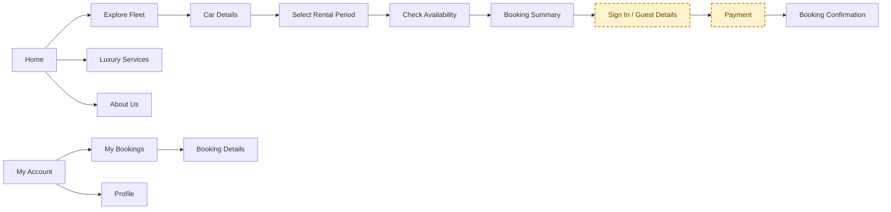
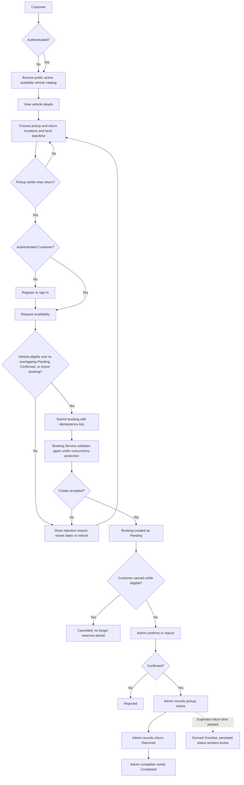
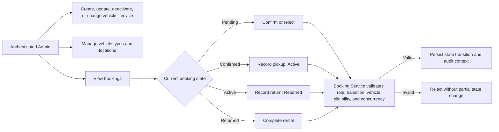

# Business Flows and Open Decisions

## Purpose and authority

This document makes the current MVP business flow visible and records unresolved decisions found while reviewing `docs/00-project-overview.md`, `docs/01-requirements.md`, `docs/02-business-rules.md`, `docs/03-use-cases.md`, and `docs/architecture/01-booking-flow.md`.

It is a review aid, not a replacement for those documents. Explicit rules in `02-business-rules.md` remain authoritative. Items marked Open below must not be silently implemented as business policy.

## Customer-facing navigation flow (requested target)

The following is the target navigation structure from the supplied diagram. Dashed amber nodes identify flows that conflict with, or are not supported by, the current MVP contract; they are requirements to resolve, not claims that those features already work.

The catalog browse step is public and read-only. Availability and booking creation still require an authenticated account. The target order therefore needs an authentication gate before availability for signed-out visitors, or an explicit product/API change. Guest checkout and payment remain outside the current MVP contract; payment processing is explicitly excluded by `docs/02-business-rules.md`. A successful current booking request creates a `Pending` booking and is not a final rental confirmation.

## Customer booking flow (current MVP baseline)

The availability check is advisory. Booking creation is authoritative and must revalidate the same business conditions; the browser must not treat an earlier positive check as a reservation. Rental periods are half-open `[PickupUtc, ReturnUtc)`, so an existing return exactly at a new pickup is not an overlap. The initial reserving states are Pending, Confirmed, and Active.

## Admin fleet and booking flow

## Business clarity review

| Area | Current clarity | Open decision / observed gap | Why it matters |
|---|---|---|---|
| Booking period and overlap | Defined: UTC, `[pickup, return)`, overlap predicate, invalid `return <= pickup`; pending/confirmed/active reserve the vehicle. | Customer-facing timezone and how local dates map to UTC are still TBD. | UI must show the same instant that the API validates; DST and timezone ambiguity can shift a reservation. |
| Availability and create | Defined: availability is advisory; Booking Service is authoritative; concurrent overlaps must not both succeed; create is idempotent. | Exact idempotency-key scope, retention, replay behavior, and precise concurrency implementation remain technical TBD. | Retry and race responses need stable client behavior; do not equate a successful availability check to a booking. |
| Initial booking decision | Defined: create starts Pending; Admin can confirm/reject. | Response/service failure after the server created a booking but before the client received the response needs a user recovery path (query by idempotency key or refresh history). | Prevents accidental duplicate submissions and uncertainty about whether a request succeeded. |
| Cancellation | Defined: customer can cancel own eligible Pending/Confirmed booking; Active and terminal states cannot be cancelled; cancellation releases its period. | Cancellation deadline, fees/refunds, admin-initiated cancellation and approval policy are TBD/out of MVP. | UI should communicate eligibility without inventing a time window or refund promise. |
| Admin lifecycle | Transition list and Admin responsibility are defined. | Rules say an approval authority is defined by an authorization matrix, but the exact matrix/role granularity is TBD; reject reason and audit fields/retention are not fully specified. | Admin screens need operation-level permissions, required fields, and audit feedback. |
| Fleet lifecycle | Status values and high-level transitions are defined. | Deactivation with future confirmed bookings, reactivation, maintenance completion, retirement approval, and location deactivation with existing bookings are TBD. | Catalog visibility, booking preservation, and operational scheduling can conflict. |
| Rental handoff | Admin records pickup and return; overdue is derived. | Required handoff checks, condition/mileage/fuel evidence, late-return policy and handling of return after expected time are TBD or out of scope. | Avoid building inspection, damage, or fee workflow without a scope decision. |
| Price and payment | Explicitly excluded from MVP; a booking need not have a price. | UI technical spec illustrates daily price, deposit, card, and payment summary without a corresponding MVP business/API contract. | UI mock content must not imply a quote, charged deposit, payment method, or completed payment. |
| Insurance, damage, AI, rating | Explicitly out of MVP (insurance/damage workflows, recommendation engine, review/rating). | UI spec describes AI assistant, insurance, damage analysis and payment prompts. No actor permissions, provider, data contract, or acceptance rules are defined. | Keep these as non-operational concepts or remove them from MVP screens. |
| Vehicle discovery/auth | Anonymous users can browse active vehicles, categories, and locations; availability and booking APIs require an authenticated account. | Supplied target diagram places sign-in/guest details after availability and booking summary, which conflicts with the availability API policy. Guest checkout remains undefined and unsupported. | Keep public discovery; decide whether to move sign-in before availability or define a safe guest booking contract. |
| Marketing claims | Home hero uses live catalog counts; the marquee shows brand wordmarks. | No authoritative customer-count/rating API is defined. Wordmarks are display text, not licensed or verified official brand assets. | Avoid invented metrics and replace wordmarks with approved brand assets if the marks are used commercially. |
| Booking details/history | History and details are required; customer can view own bookings. | Error, pagination, empty/loading states are described only at a high level; API exposes paginated history. | FE should retain ownership and pagination semantics instead of assuming an unbounded list. |

### Contradictions or documentation alignment to resolve

1. The UI specification describes Supercars/SUVs/Sedans/Convertibles, while vehicle types are catalog data and the exact supported taxonomy is TBD. Render API-provided types; do not hard-code taxonomy as policy.
2. UI examples include payment/insurance/damage-analysis/AI functions; current business rules mark payment and related flows out of scope. Keep them non-functional or remove until scope is approved.
3. Requirements call booking details and admin booking lifecycle management, but the current frontend surface primarily exposes booking history and basic cancel/operations. Treat this as an implementation gap, not permission to infer missing policy.
4. Some introductory overview prose simplifies the lifecycle, while the current baseline adds `Returned` and derived `Overdue`. Use the detailed status baseline and transition table in `02-business-rules.md` as authoritative.

## Recommended order to close open decisions

1. Decide whether sign-in remains required before availability or define a safe guest availability/checkout contract.
2. Define guest identity, verification, ownership, cancellation, and booking-history rules if guest checkout is intended.
3. Define timezone display/conversion and minimum/maximum/advance booking constraints.
4. Define cancellation cutoff and whether Admin may cancel on behalf of a customer.
5. Define fleet deactivation/location-change behavior for future confirmed bookings.
6. Define the minimum Admin operation permission matrix and required reject/audit data.
7. Decide whether pricing/payment remains out of scope; if so, keep payment as a future-state step and remove payment-like claims.

Items in this list are decisions for the business owner; the review does not choose values for them.
