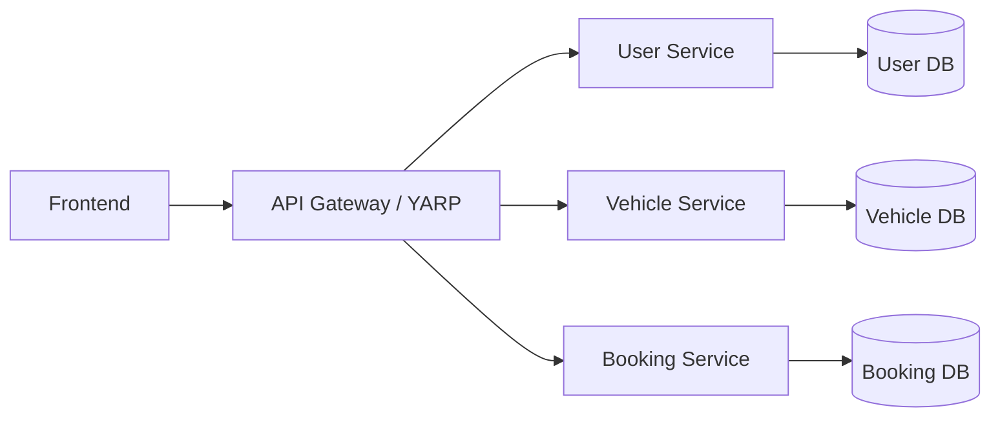

# 01. Backend Architecture

## 1. Purpose

This document defines the approved backend architecture for the current Vehicle Rental System scope.

It is a technology decision document, not an implementation plan. It explains why the selected backend structure is appropriate for the documented requirements, service boundaries, and booking correctness goals.

---

## 2. Architecture Summary

The backend uses a small, explicit three-service architecture aligned to the project definition:

- User Service
- Vehicle Service
- Booking Service

Each service owns its own database and is responsible for its own domain data.

---

## 3. Architectural Decision

### Decision
The backend architecture will remain a small, synchronous, three-service system for the current phase.

### Reason
This matches the project’s stated scope, service boundaries, and correctness-first delivery strategy.

### Traceability
- Project overview: 2-3 backend services, database-per-service model, no unnecessary services
- Requirements: booking correctness, user/admin separation, service ownership constraints
- Domain model: User, Vehicle, VehicleType, Location, Booking ownership
- Service boundaries: User Service, Vehicle Service, Booking Service

---

## 4. Service Responsibilities

### User Service
Responsible for:
- user registration
- authentication
- authorization context
- user profile lifecycle
- role management

It does not own vehicle data or booking correctness.

### Vehicle Service
Responsible for:
- vehicle catalog
- vehicle type master data
- location master data
- vehicle lifecycle status management

It does not own booking creation or overlap validation.

### Booking Service
Responsible for:
- booking creation
- booking retrieval
- lifecycle validation
- rental-period validation
- overlap prevention
- cancellation eligibility checks

This service is the authoritative boundary for booking correctness.

---

## 5. Why This Architecture Fits the Project

### Requirement alignment
- The system must support customer and admin capabilities without duplicating ownership.
- The system must preserve booking correctness as the critical business problem.
- The system must not allow cross-service database joins.

### Architectural fit
This design keeps ownership clear, the domain boundaries narrow, and the execution model understandable for a single developer.

---

## 6. Technology Decisions with Architecture Traceability

| Capability | Decision | Status |
|---|---|---|
| Backend framework | ASP.NET Core | REQUIRED_NOW |
| .NET runtime version | TBD, project-appropriate baseline | TBD |
| API layer | ASP.NET Core Web API | REQUIRED_NOW |
| Data access | EF Core | REQUIRED_NOW |
| Database | SQL Server | REQUIRED_NOW |
| Identity/auth | ASP.NET Core authentication and JWT-based access model | REQUIRED_NOW |
| Gateway | YARP | IMPLEMENTED |
| Redis | Required only later for read-model optimization | REQUIRED_LATER |
| Kafka | Required only when async integration is justified | REQUIRED_LATER |
| Logging | ASP.NET Core logging + structured logging approach when needed | REQUIRED_NOW |
| Observability | OpenTelemetry deferred until required by runtime learning goals | REQUIRED_LATER |
| Validation | Built-in ASP.NET Core validation first; FluentValidation only if complexity requires it | REQUIRED_NOW |
| Testing | xUnit for backend tests | REQUIRED_NOW |

---

## 7. Technology Constraints

The following are intentionally not adopted for the current architecture phase:

- additional microservices
- payment or pricing services
- notification or search services
- distributed locking infrastructure as a default design
- Kafka before synchronous correctness is stable
- Redis before a measured read-access requirement exists

---

## 8. Non-Goals for This Architecture Phase

This architecture intentionally avoids:

- broad event-driven choreography before the baseline is stable
- distributed caching before a real performance problem exists
- large-scale observability instrumentation before the system is functionally correct
- extra abstraction layers that do not solve a current need

---

## 9. Decision Summary

| Topic | Decision | Status |
|---|---|---|
| Backend platform | ASP.NET Core | REQUIRED_NOW |
| Service model | 3 backend services | REQUIRED_NOW |
| Database ownership | Database-per-service | REQUIRED_NOW |
| Booking correctness ownership | Booking Service | REQUIRED_NOW |
| Gateway | YARP | REQUIRED_LATER |
| Redis | Deferred | REQUIRED_LATER |
| Kafka | Deferred | REQUIRED_LATER |
| Structured logging | Use framework-native logging first | REQUIRED_NOW |
| OpenTelemetry | Deferred | REQUIRED_LATER |
| Validation library | Native ASP.NET validation first | REQUIRED_NOW |
