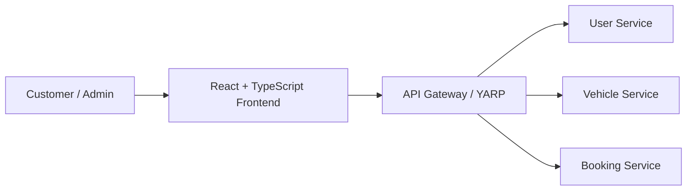

# 01. Frontend Architecture

## 1. Purpose

This document defines the frontend architecture for the current Vehicle Rental System scope.

It focuses on the architectural choices justified by the project definition and the earlier backend and business documentation. It does not define component-level implementation details or UI library usage beyond what is required for a justified decision.

---

## 2. Frontend Summary

The frontend is a React + TypeScript application that exposes the customer and admin user interface to the system.

It communicates with the backend through an API Gateway and then into the appropriate backend service.

---

## 3. Architectural Decision

### Decision
The frontend remains a small, single-application client that consumes the backend through a central API Gateway boundary.

### Reason
The project overview calls for a single frontend and a small, learning-focused architecture. The frontend is a user interface layer, not a business owner.

---

## 4. Frontend Responsibilities

### Customer UI
- login and registration
- vehicle list and filtering
- vehicle details
- availability checks
- booking creation
- booking history
- booking details
- booking cancellation

### Admin UI
- dashboard
- vehicle management
- vehicle type management
- location management
- booking management

---

## 5. Architectural Boundaries

### Client layer
- React renders the user interface and manages local UI state.
- The frontend is not responsible for owning system data.

### API boundary
- The frontend calls the API Gateway.
- The gateway routes requests to the appropriate backend service.

### Authentication boundary
- Auth tokens or authenticated sessions are validated before protected operations proceed.
- Exactly how the token flows between the frontend and backend remains `TBD`.

### Service dependency model
- The frontend depends on backend services through public request flows.
- The frontend does not directly own or maintain service data foundations.

---

## 6. Why This Fits the Project

- It matches the project definition for a single React + TypeScript frontend.
- It is consistent with the project’s small initial architecture and incremental learning model.
- It keeps UI concerns separate from booking, vehicle, and user domain logic.

---

## 7. Frontend Technology Constraints

The project does not justify introducing a large frontend stack at this stage.

The system should prefer:
- native React patterns
- TypeScript for typing
- minimal state management unless a clear need emerges
- simple HTTP usage via native browser capabilities when sufficient

This keeps the frontend aligned with the project principle: do not add infrastructure or abstractions without a requirement.

---

## 8. Frontend Decision Summary

| Area | Decision | Status |
|---|---|---|
| Frontend framework | React | REQUIRED_NOW |
| Type system | TypeScript | REQUIRED_NOW |
| Build tool | Vite | REQUIRED_NOW |
| Styling | Tailwind v4 for Shadcn; local CSS during migration | REQUIRED_NOW |
| UI library | Shadcn UI source-owned components | REQUIRED_NOW |
| HTTP client | Fetch API preferred | REQUIRED_NOW |
| Server-state management | Native React patterns first | REQUIRED_NOW |
| Client-state management | React Context / local state first | REQUIRED_NOW |
| Form validation | Native form validation / minimal validation library if needed | REQUIRED_NOW |
| Date handling | Native Date + Intl preferred | REQUIRED_NOW |
| Icons | Lucide React | REQUIRED_NOW |
| Global state library | Not required by default | TBD |
| Component library | Shadcn UI | REQUIRED_NOW |

---

## 9. Architecture Traceability

The frontend architecture is justified by:

- project overview: React + TypeScript frontend and customer/admin UI requirements
- requirements: customer browsing, search, booking flows, admin management flows
- system architecture: external frontend through gateway to backend services
- service boundaries: frontend is not a service owner and should not directly own business data

---

## 10. Unresolved Notes

The following frontend design details remain `TBD` until the implementation stage:

- exact auth token flow to the API Gateway
- exact page-level composition and route structure
- migration boundaries for remaining local CSS and Shadcn primitives
- whether client-side caching is necessary for list screens
- whether a server-state helper is needed beyond native React patterns
